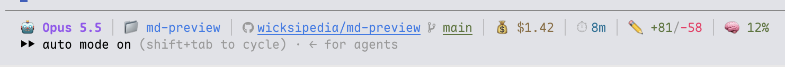

# statusline

A status line for [Claude Code](https://claude.com/claude-code).



## What it shows

| Part | Source | Notes |
|---|---|---|
| 🤖 Model | Claude Code | The display name, such as Opus 5.5. |
| 📁 Folder | Claude Code | The last part of the working folder. It is a `file://` link, so you can open the folder in Finder or your file manager. |
| Repo | `git remote get-url origin` | A link to the repo's web page. The icon takes the colour of its host. |
| Branch | `git symbolic-ref` | A link to the branch on the host. If HEAD is detached, it shows the short commit ID instead. Outside a repo, this part is hidden. |
| 💰 Cost | Claude Code | The session cost in US dollars. |
| ⏱ Time | Claude Code | Minutes since the session started. |
| ✏️ Lines | Claude Code | Lines added and removed in this session. |
| 🧠 Context | Claude Code | How much of the context window you used. It turns yellow at 50% and red at 80%. |

If Claude Code does not send a value, the script hides that part.

The folder, repo and branch links work in terminals that support OSC 8 hyperlinks, such as iTerm2, WezTerm, Kitty, Ghostty and bigtty. Your terminal sets the key you hold to open a link. On macOS, iTerm2 and Ghostty use Cmd+click. In bigtty, Ctrl+click opens the link in Finder or your browser, and Cmd+click opens it in a bigtty pane. The repo icon colours are GitLab orange, Azure DevOps blue and Bitbucket blue. GitHub uses your terminal's text colour, because its brand black disappears on dark themes.

Supported remotes: GitHub, GitLab, Azure DevOps (`dev.azure.com` and `visualstudio.com`) and Bitbucket, over SSH or HTTPS. Other hosts get a generic git icon and a best-guess web link. Local paths get no link.

The status line does not show your plan usage, such as the five-hour session window or the weekly limit. [Omacchiato](https://github.com/wicksipedia/omacchiato) shows those in its AI usage pill on the macOS menu bar.

## Requirements

- `bash`, `git` and [`jq`](https://jqlang.org)
- A [Nerd Font](https://www.nerdfonts.com) in your terminal, for the repo and branch icons

## Install

Copy the script into your Claude Code folder:

```sh
curl -o ~/.claude/statusline.sh https://raw.githubusercontent.com/wicksipedia/statusline/main/statusline.sh
```

Add this to `~/.claude/settings.json`:

```json
"statusLine": {
  "type": "command",
  "command": "bash ~/.claude/statusline.sh"
}
```

The status line appears on the next refresh.

## Safety

The script strips terminal control codes from the model, folder, branch and remote before it prints them. If a remote URL still has odd characters after that, the script shows no repo link.

## Tests

Run `bash test.sh`. It builds throwaway repos in a temp folder and checks the links, icon colours and control-code stripping.

## Licence

MIT
